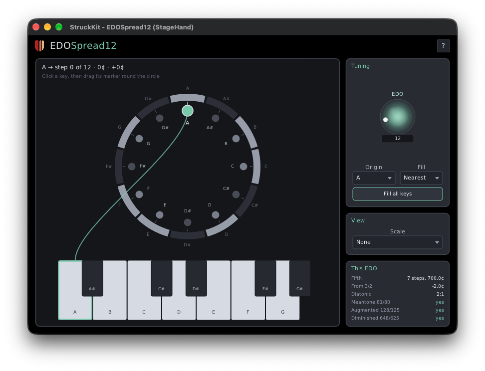

# EDOSpread12

A MIDI note effect from Unlikelyware that plays any equal division of the octave (EDO) from an
ordinary 12-key keyboard. Each of the 12 keys in an octave is given its own step of the N-EDO
octave, and the pattern repeats every octave. Put it in front of a synth and a piano keyboard plays
19-EDO, 31-EDO or any EDO from 1 to 96, with the keys going where you put them.

EDOSpread12 makes no sound of its own. It changes the notes going to the synth after it.



| | |
|---|---|
| Format | CLAP |
| Platforms | Linux x86-64, macOS 26 or later on Apple Silicon. No Windows |
| Version | 0.9.0 (preview) |
| License | MIT |

**Downloads:** ready-built plugins will be on itch.io with the 0.9 preview. This repo has the
source only.

## How it maps

- **The Origin** (a pitch class, A by default) is step 0, and plays at its usual pitch. The octave
  counts from it, so with an A origin the 12 keys are A, A#, B … G#.
- **Each key gets a step** from 0 to N, where N is the next origin, an octave up. Keys may be out of
  order or share a step: below 12-EDO some must.
- **Fill** gives all 12 keys their steps at once: **Nearest** puts each key on the step nearest its
  usual pitch, **Floor** on the highest step not above it. Then move any key by hand.

With an A origin in 19-EDO, Nearest puts C on step 5: 316¢ above A, 16¢ sharp of its usual pitch.

## The editor

A step circle of the chosen EDO, its ring shaded like a piano octave bent round (dark arcs for the
black keys, light for the white), so you can see which familiar key each step is near. Below it, the
octave's 12 keys, laid out straight. Click a key and a curve joins it to its marker on the circle;
drag the marker round to give the key another step. Keys out of order or sharing a step are marked,
and the keys you're playing light up. The **?** at the top right opens the full help page
([resources/help.md](resources/help.md)) in your browser.

## Parameters

| Parameter | Range | Default |
|---|---|---|
| EDO | 1 … 96: N, the steps per octave | 12 |
| Origin | C … B: the key that's step 0 | A |
| Fill | Floor, Nearest | Nearest |
| Step A … Step G# | 0 … N: each key's step, named for its key from the origin | the 12-EDO steps |

The defaults leave every note where it was. Turning EDO or choosing a Fill in the editor refills all
12 keys; a host automating EDO only clamps the steps to the new range, so it never undoes your
edits. Notes moved out of MIDI's 0–127 range are dropped. Everything that isn't a note (CCs,
channel pitch bend, program change, SysEx, clock) passes through unchanged.

## What makes it different

- **MIDI 2.0 first.** A note keeps its exact pitch as a Pitch 7.9 attribute on the Note On, so a
  synth that reads it plays the EDO step, not the nearest semitone.
- **MIDI 1.0 in, MIDI 2.0 out** where the host takes MIDI 2.0: a MIDI 1.0 note that lands between
  semitones goes out as MIDI 2.0 rather than being rounded away. One that lands on a semitone stays
  MIDI 1.0.
- **The CLAP note dialect too.** Hosts such as Bitwig send plugins CLAP notes. There EDOSpread12 sends
  the nearest key plus a tuning expression with the rest, so a synth that honours tuning expressions
  hears the step.
- **No stuck notes.** Each sounding note remembers where it went, so changing the map while notes
  are held moves only new notes. Two keys landing on one step end cleanly.

## Which hosts keep the microtones

| Host | What EDOSpread12 gets | Microtonal output |
|---|---|---|
| [StageHand](https://github.com/erickampman/StageHand) | MIDI 2.0 | Yes (Pitch 7.9) |
| Bitwig | CLAP notes | Yes, to a synth that honours tuning expressions |
| Hosts that take no MIDI 2.0 and send MIDI 1.0 | MIDI 1.0 | Rounded to semitones |

The Unlikelyware synths ([PlainOldSynth](https://github.com/erickampman/PlainOldSynth),
[StruckSynth](https://github.com/erickampman/StruckSynth) and the rest) play Pitch 7.9 notes.

## Installing

The download holds `EDOSpread12.clap`. Put it in your CLAP folder (create the folder if it isn't
there), then rescan plugins in your host:

| | Linux | macOS |
|---|---|---|
| For you | `~/.clap` | `~/Library/Audio/Plug-Ins/CLAP` |
| For every user | `/usr/lib/clap` | `/Library/Audio/Plug-Ins/CLAP` |

On macOS, `~/Library` is hidden in Finder: Go ▸ Go to Folder opens it. The 0.9 previews aren't
notarized, so macOS won't load a downloaded plugin until its quarantine flag is cleared:

```bash
xattr -dr com.apple.quarantine ~/Library/Audio/Plug-Ins/CLAP/EDOSpread12.clap
```

A host that is already running keeps the plugins it loaded: quit and restart it. To build
EDOSpread12 yourself instead, see below; `cmake --build build --target install-clap` then links the
build into your CLAP folder.

## Building from source

```bash
git clone https://github.com/erickampman/EDOSpread12.git
cd EDOSpread12
tools/fetch_deps.sh
cmake -B build -G Ninja -DCMAKE_BUILD_TYPE=Release
cmake --build build
```

[BUILDING.md](BUILDING.md) has the prerequisites for Linux and macOS, how to install a copy instead
of a link, and the editor's preview app. [docs/design.md](docs/design.md) explains how it works.

## Help and bugs

Questions and bug reports go to [GitHub Issues](https://github.com/erickampman/EDOSpread12/issues).

## License

MIT. See [LICENSE](LICENSE). The third-party components in the plugin, and their licenses, are in
[THIRD_PARTY_NOTICES.md](THIRD_PARTY_NOTICES.md).

## Trademarks

Mac and macOS are trademarks of Apple Inc., registered in the U.S. and other countries. Linux is the
registered trademark of Linus Torvalds in the U.S. and other countries. Other product names are
trademarks of their owners, named here only to say what works with what.
